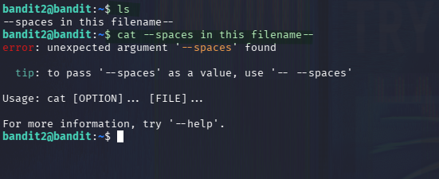
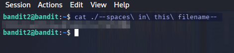

## Executive Summary
Bandit Level 2 builds on the previous level's lesson about special filenames. This time the filename contains **spaces**, which the shell treats as argument separators by default. The level teaches two standard techniques for passing such filenames to a command: quoting the argument and escaping each space with a backslash. It also reinforces the `./` prefix from Level 1 to guard against filenames beginning with a dash.

## Objective
- Authenticate to the Bandit server as `bandit2`.
- Read the password for the next level from a file whose name contains spaces.

## Scope
- Target: `bandit.labs.overthewire.org` on port `2220`.
- Focus: shell word splitting, quoting, escaping, special filenames.

## Challenge Description
On login, `ls` reveals a single file whose name is:

```
--spaces in this filename--
```

The filename contains both a leading double dash and embedded spaces, which means a naive `cat --spaces in this filename--` will be split by the shell into four separate arguments and fail. As we can see in the picture below.

{: .writeup-image}

## Methodology
1. Reconnaissance: Log in and list the home directory.
2. Identification: Recognize that spaces in the filename will cause
   word splitting.
3. Extraction: Pass the filename as a single argument using quoting or
   backslash escaping, with a `./` prefix to avoid the leading-dash
   ambiguity.
4. Validation: Confirm the password is printed.

## Commands Used                             |

- `ssh` -> Remote shell access                  
- `ls`  -> Directory listing                    
- `cat` -> File content display                

## Key Findings
- The shell splits unquoted arguments on whitespace, so filenames with
  spaces must be quoted or escaped.
- A filename that begins with `--` is still interpreted as an option,
  so the `./` prefix from Level 1 remains relevant.
- Three equivalent techniques work: double quotes, single quotes, and
  backslash escaping.

## Technical Reconstruction

### Reconnaissance
Log in as `bandit2` using the password recovered in the previous level:

```bash
ssh bandit2@bandit.labs.overthewire.org -p 2220
```

List the home directory:

```bash
ls
```

Output:

```
--spaces in this filename--
```

### Identification
Two distinct hazards are present in this single filename:

1. **Spaces** the shell treats them as argument separators, so
   `cat --spaces in this filename--` becomes four arguments:
   `--spaces`, `in`, `this`, `filename--`.
2. **Leading double dash** even if the spaces were handled, the shell
   would still see `--spaces` as a long option.

Both problems must be addressed at once.

### Extraction
The solution is to pass the entire filename as a single, unambiguous
argument. There are three standard ways:

**Option 1 Backslash escaping:**
{: .writeup-image}


Each space is escaped with `\`, and the `./` prefix removes the leading-
dash ambiguity.

**Option 2 - Double quotes:**

```bash
cat "./--spaces in this filename--"
```

The double quotes group the whole string into one argument, and `./`
still handles the leading dash.

**Option 3 — Single quotes:**

```bash
cat './--spaces in this filename--'
```

Equivalent to double quotes here. Prefer single quotes when the
filename contains characters that the shell would otherwise expand
(`$`, backticks, etc.).

All three produce the same output:

That string is the password for **Bandit3**.

> The password is redacted in accordance with OverTheWire's published
> rules, which prohibit posting spoilers.

## Remediation
Not applicable.


## Conclusion
Level 2 shows that the shell is a text-driven system, and any character
with special meaning, a space, a dash, a quote, has to be handled deliberately. 